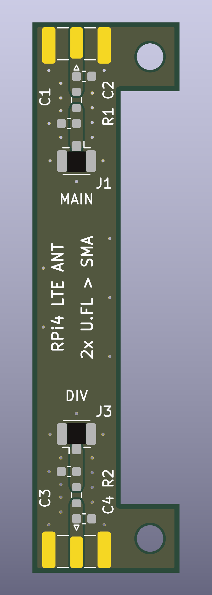

# Raspberry Pi 4 LTE çift anten adaptörü

Raspberry Pi 4'ün montaj deliklerine oturan, harici bir LTE modemin iki U.FL anten çıkışını (MAIN ve DIV) iki SMA dişi konnektöre taşıyan pasif kart.



## Durum

Bu kart henüz üretilmedi ve ölçülmedi. Aşağıdakiler yalnızca tasarım araçlarıyla doğrulandı:

- Şema denetimi (ERC): 0 hata, 0 uyarı
- Tasarım kuralı denetimi (DRC): 0 ihlal, 0 bağlanmamış pad
- Şema–kart eşleşmesi: 0 fark

Doğrulanmayanlar:

- 50 Ω hat empedansı formülle hesaplandı (FR4, εr ≈ 4,5, 1,6 mm); simülasyon veya ağ analizörü ölçümü yok.
- Pi 4'e mekanik uyum standart Pi 4 ölçülerine dayanıyor (delikler kenardan 3,5 mm, 49 mm aralık); gerçek kart üzerinde denenmedi. Sipariş öncesi 1:1 çıktı alıp deneyin.

## Özellikler

| | |
|---|---|
| Boyut | 15 × 56 mm, C biçiminde |
| Katman | 2 katman, 1,6 mm FR4 |
| RF hatları | 2 adet, 50 Ω topraklı eş düzlemli hat (1,27 mm iz, 0,2 mm boşluk) |
| Frekans | LTE bantları (700–2700 MHz) için tasarlandı |
| Giriş | 2 × U.FL (J1 = MAIN, J3 = DIV) |
| Çıkış | 2 × kenar montajlı SMA dişi (J2 = MAIN, J4 = DIV) |
| Montaj | 2 × M2.5 delik, Pi 4'ün SD kart tarafındaki kısa kenarı |

İki SMA kartın karşılıklı uçlarında durur; antenler arası mesafe yaklaşık 75 mm olur. C biçimi Pi 4'ün DSI ekran konnektörünü açıkta bırakır.

## Elektriksel bağlantı

Kart tamamen pasiftir; güç veya GPIO bağlantısı yoktur. Toprak, koaksiyel kabloların ekranı üzerinden gelir.

```
LTE modem MAIN (U.FL) ── kablo ── J1 ── R1 (0 Ω) ── J2 (SMA) ── ana anten
LTE modem DIV  (U.FL) ── kablo ── J3 ── R2 (0 Ω) ── J4 (SMA) ── çeşitleme anteni
```

- Modem, U.FL çıkışlı herhangi bir LTE modülü olabilir (USB, mini-PCIe veya M.2). Pi 4'ün kendisinde LTE modem yoktur.
- MAIN anten hem alır hem verir; DIV (bazı modüllerde AUX) yalnızca alır.
- GNSS/GPS çıkışı için üçüncü bir hat yoktur.
- Modemi anten takılı değilken çalıştırmayın.

## Malzeme listesi

| Referans | Parça | Adet | Not |
|---|---|---|---|
| J1, J3 | Hirose U.FL-R-SMT-1 | 2 | U.FL soket |
| J2, J4 | Samtec SMA-J-P-H-ST-EM1 | 2 | 1,6 mm kart için kenar montajlı SMA dişi |
| R1, R2 | 0 Ω, 0603 | 2 | Takılmazsa hat açık devre kalır |
| C1–C4 | 0603 | 0 | Takılmaz; anten uyumlama için boş yer |
| — | U.FL–U.FL kablo, 1,13 mm, 5–15 cm | 2 | Modem ile kart arası |
| — | M2.5 aralayıcı, en az 11 mm | 2 | Kartı GPIO pinlerinin üstünde tutar |
| — | SMA erkek LTE anteni | 2 | |

Başka bir kenar montajlı SMA kullanacaksanız pad ölçülerini footprint ile karşılaştırın.

## Üretim

`rpi4-lte-anten-adaptor-gerber.zip` dosyasını PCB üreticisine yükleyin. Sipariş ayarları: 2 katman, 1,6 mm FR4. Hat empedansı bu kalınlığa göre hesaplandığı için farklı kalınlık seçmeyin.

## Montaj

1. J1, J3 (U.FL), R1, R2 (0 Ω) ve J2, J4 (SMA) parçalarını lehimleyin. SMA'nın orta pini üst yüzdeki orta pad'e, toprak ayakları iki yüzdeki yan pad'lere gelir.
2. Multimetreyle kontrol edin: her SMA'nın orta pini ile kendi U.FL orta pini arasında süreklilik olmalı, orta pin ile toprak arasında kısa devre olmamalı.
3. Kartı iki M2.5 aralayıcıyla Pi 4'ün SD kart tarafındaki kısa kenarına, SMA'lar uzun kenarlara bakacak şekilde takın.
4. U.FL kabloları modemin MAIN ve DIV çıkışlarından J1 ve J3'e bağlayın, antenleri takın.

## Dosyalar

| Dosya | İçerik |
|---|---|
| `rpi4-lte-anten-adaptor.kicad_pro` / `.kicad_sch` / `.kicad_pcb` | KiCad 9 projesi |
| `sema.pdf` | Şema |
| `gerber/` | Gerber ve delik dosyaları |
| `rpi4-lte-anten-adaptor-gerber.zip` | Üreticiye yüklenecek paket |
| `drc-raporu.txt` | DRC raporu |
| `onizleme-ust.png`, `onizleme-alt.png` | Kartın üst ve alt görünümü |

## Wi-Fi sürümü

[`wifi/`](wifi/README.md) klasöründe aynı biçimde, tek hatlı bir kart daha var: Pi 4'ün dahili Wi-Fi/Bluetooth radyosu için 1 × U.FL → 1 × SMA adaptörü. LTE kartından farklı olarak Pi üzerinde lehim değişikliği gerektirir; ayrıntılar ve uyarılar o klasördeki README'de.

## Nasıl tasarlandı

KiCad 9.0.9 ile, [KiCAD-MCP-Server](https://github.com/mixelpixx/KiCAD-MCP-Server) v2.8.3 üzerinden Claude tarafından tasarlandı.
