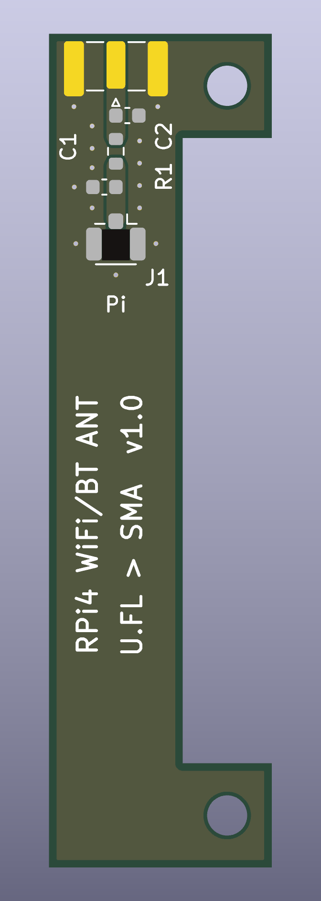

# Raspberry Pi 4 Wi-Fi/Bluetooth harici anten adaptörü

Raspberry Pi 4'ün dahili Wi-Fi/Bluetooth radyosunu tek bir kenar montajlı SMA dişi konnektöre taşıyan pasif kart. [LTE kartıyla](../README.md) aynı biçimde ve aynı montaj deliklerinde, tek RF hattıyla.



## Önemli uyarı

Bu kart tek başına yetmez. Pi 4'ün anten çıkışında hazır bir U.FL soket yoktur; sinyali dahili antenden ayırıp bir U.FL sokete yönlendirmek için Pi üzerinde lehim değişikliği gerekir.

- Değişiklik 0201 boyutunda (0,6 × 0,3 mm) bir parça içerir; hata Pi'nin Wi-Fi/Bluetooth'unu kalıcı olarak bozabilir.
- Değişiklik Pi'nin radyo sertifikasını (CE/FCC) geçersiz kılar. Yüksek kazançlı anten yasal yayın gücü sınırını aşabilir.
- Pi tarafındaki adımlar bu projede denenmedi ve doğrulanmadı. Başlamadan önce Pi 4'e özel bir kaynağa bakın, örneğin [element14: External Antenna for Raspberry Pi 4](https://community.element14.com/products/raspberry-pi/b/blog/posts/external-antenna-for-raspberry-pi-4).

## Durum

Bu kart henüz üretilmedi ve ölçülmedi. Yalnızca tasarım araçlarıyla doğrulandı:

- Şema denetimi (ERC): 0 hata, 0 uyarı
- Tasarım kuralı denetimi (DRC): 0 ihlal, 0 bağlanmamış pad
- Şema–kart eşleşmesi: 0 fark

50 Ω hat empedansı formülle hesaplandı (FR4, εr ≈ 4,5, 1,6 mm); simülasyon veya ölçüm yok. Pi 4'e mekanik uyum standart Pi 4 ölçülerine dayanıyor, gerçek kart üzerinde denenmedi.

## Özellikler

| | |
|---|---|
| Boyut | 15 × 56 mm, C biçiminde |
| Katman | 2 katman, 1,6 mm FR4 |
| RF hattı | 1 adet, 50 Ω topraklı eş düzlemli hat (1,27 mm iz, 0,2 mm boşluk), yaklaşık 8 mm |
| Frekans | 2,4 GHz ve 5 GHz Wi-Fi/Bluetooth |
| Giriş | 1 × U.FL (J1, Pi tarafı) |
| Çıkış | 1 × kenar montajlı SMA dişi (J2) |
| Montaj | 2 × M2.5 delik, Pi 4'ün SD kart tarafındaki kısa kenarı |

## Elektriksel bağlantı

```
Pi 4 Wi-Fi çıkışı ── (Pi'ye lehimlenen U.FL) ── kablo ── J1 ── R1 (0 Ω) ── J2 (SMA) ── anten
```

Kart pasiftir; güç veya GPIO bağlantısı yoktur. Bluetooth aynı anteni kullandığı için o da harici antene geçer. Anten takılı değilken Pi'nin Wi-Fi'ını çalıştırmayın.

## Malzeme listesi

| Referans | Parça | Adet | Not |
|---|---|---|---|
| J1 | Hirose U.FL-R-SMT-1 | 1 | U.FL soket |
| J2 | Samtec SMA-J-P-H-ST-EM1 | 1 | 1,6 mm kart için kenar montajlı SMA dişi |
| R1 | 0 Ω, 0603 | 1 | Takılmazsa hat açık devre kalır |
| C1, C2 | 0603 | 0 | Takılmaz; anten uyumlama için boş yer |
| — | U.FL–U.FL kablo, 1,13 mm, 5–10 cm | 1 | Pi ile kart arası |
| — | M2.5 aralayıcı, en az 11 mm | 2 | Kartı GPIO pinlerinin üstünde tutar |
| — | SMA erkek 2,4/5 GHz anten | 1 | Tüketici Wi-Fi antenlerinin çoğu RP-SMA'dır, uymaz |

## Üretim

`rpi4-anten-adaptor-gerber.zip` dosyasını PCB üreticisine yükleyin. Sipariş ayarları: 2 katman, 1,6 mm FR4.

## Dosyalar

| Dosya | İçerik |
|---|---|
| `rpi4-anten-adaptor.kicad_pro` / `.kicad_sch` / `.kicad_pcb` | KiCad 9 projesi |
| `sema.pdf` | Şema |
| `gerber/` | Gerber ve delik dosyaları |
| `rpi4-anten-adaptor-gerber.zip` | Üreticiye yüklenecek paket |
| `drc-raporu.txt` | DRC raporu |
| `onizleme-ust.png`, `onizleme-alt.png` | Kartın üst ve alt görünümü |
